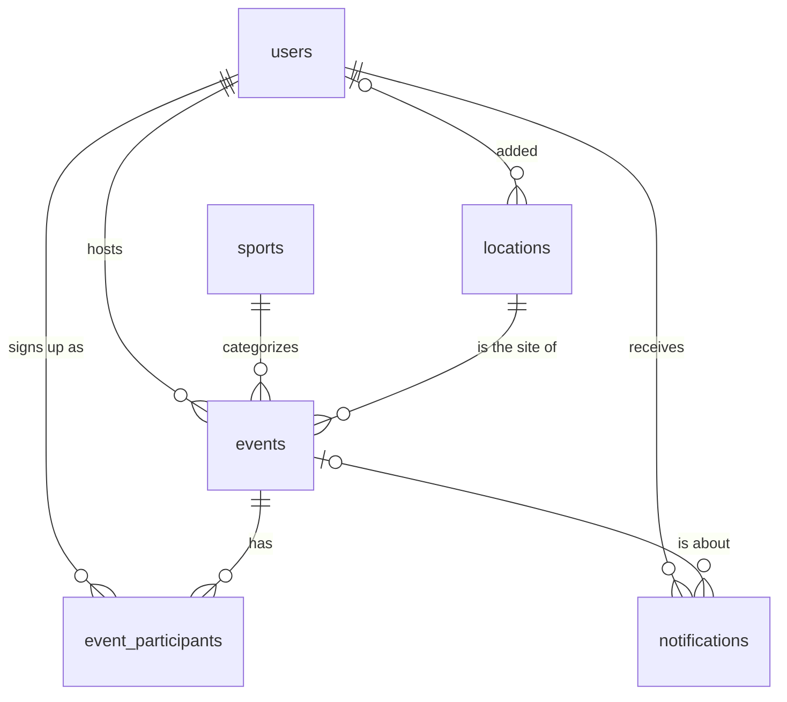

# Pickup-Finder Database

**Owner:** Jun
**Engine:** PostgreSQL 16
**Status:** Draft. The repo doesn't have any database files yet, so the folder layout, schema, and Docker setup below are a **proposal** for the team to review. Once `database/init/create.sql` exists, that file is the source of truth and this README should be kept in sync with it.

The step-by-step plan for building the database lives in [PLAN.md](PLAN.md).

**Extra credit:** the [Risks](#risks) section at the end of this file is our submission for extra credit.

## Contents

- [Overview](#overview)
- [Folder layout](#folder-layout-proposed)
- [Setup](#setup)
- [Connecting](#connecting)
- [Schema](#schema-proposed)
- [How the schema covers the requirements](#how-the-schema-covers-the-requirements)
- [Query patterns](#query-patterns)
- [Changing the schema](#changing-the-schema)
- [Seed data](#seed-data)
- [Conventions](#conventions)
- [Risks](#risks)

## Overview

Pickup-Finder lets people post and join local pickup games. The database stores:

- **Accounts:** users, their hashed passwords, and their profiles.
- **Games:** events, the sport being played, where it is (with map coordinates), and who has joined.
- **Notifications:** messages like "someone joined your game" or "this game was cancelled".
- **Login sessions:** so users stay logged in across page loads and server restarts.

It assumes the usual CSCI 3308 stack:

- PostgreSQL runs as the `db` service in Docker Compose and builds its tables from SQL files the first time it starts.
- The Node/Express server connects with [`pg-promise`](https://github.com/vitaly-t/pg-promise).
- Login sessions use `express-session` with the [`connect-pg-simple`](https://github.com/voxpelli/node-connect-pg-simple) store, so they're saved in PostgreSQL.
- The server hashes passwords with `bcrypt` (or `bcryptjs`) before saving them. The database only ever sees the hash.
- Uploaded images are saved as files, and the database stores their paths.

## Folder layout (proposed)

```text
.
├── docker-compose.yml        # defines the db service (and the server)
├── .env.example              # template for .env, committed
├── .env                      # real values, NOT committed
└── database/
    ├── README.md             # this file
    ├── PLAN.md               # build plan
    ├── init/                 # run automatically on the first `docker compose up`
    │   ├── create.sql        # tables, constraints, indexes
    │   └── insert.sql        # sample data for development
    └── migrations/           # numbered schema changes, once there's data to keep
```

PostgreSQL runs the files in `init/` in alphabetical order, so `create.sql` runs before `insert.sql`. If you add more init files, keep that order in mind.

## Setup

### With Docker (recommended)

You need Docker Desktop (or Docker Engine with the Compose plugin).

1. Copy the env template and fill in a password:

   ```bash
   cp .env.example .env
   ```

   ```dotenv
   # .env.example
   POSTGRES_USER=postgres
   POSTGRES_PASSWORD=change_me
   POSTGRES_DB=pickup_finder
   POSTGRES_HOST=db
   POSTGRES_PORT=5432
   SESSION_SECRET=replace_with_a_long_random_string
   ```

2. Add the `db` service to `docker-compose.yml`:

   ```yaml
   services:
     db:
       image: postgres:16
       env_file: .env
       ports:
         - "5432:5432"   # only needed to connect from your laptop (psql, pgAdmin, etc.)
       volumes:
         - pickup-db-data:/var/lib/postgresql/data
         - ./database/init:/docker-entrypoint-initdb.d
       healthcheck:
         test: ["CMD-SHELL", "pg_isready -U $${POSTGRES_USER} -d $${POSTGRES_DB}"]
         interval: 5s
         timeout: 5s
         retries: 5

     web:
       # ... server settings, owned by the server teammate ...
       env_file: .env
       depends_on:
         db:
           condition: service_healthy   # wait until Postgres accepts connections

   volumes:
     pickup-db-data:
   ```

3. Start the database:

   ```bash
   docker compose up -d db
   ```

   On the first start, Postgres creates the `POSTGRES_USER` account and the `POSTGRES_DB` database, then runs `create.sql` and `insert.sql`. Check that it worked with `docker compose logs db`, which should show a "running /docker-entrypoint-initdb.d/create.sql" line.

4. To wipe the database and rebuild it from the SQL files:

   ```bash
   docker compose down -v   # -v deletes the data volume, so all local data is lost
   docker compose up -d db
   ```

> **Important:** the init scripts and the `POSTGRES_*` variables only take effect when the data volume is empty. If you edit `create.sql` or change the password in `.env`, nothing happens until you run `docker compose down -v`.

If you already have PostgreSQL running on your laptop (from a lab or Homebrew), port 5432 will be taken. Change the mapping to `"5433:5432"` and connect your tools to port 5433. The server container is unaffected and still uses `db:5432`.

### Without Docker (optional)

The class requires the app to run in Docker, so use this only for quick local experiments. On macOS with Homebrew:

```bash
brew install postgresql@16
brew services start postgresql@16
export PATH="$(brew --prefix postgresql@16)/bin:$PATH"

createdb pickup_finder
psql -d pickup_finder -f database/init/create.sql
psql -d pickup_finder -f database/init/insert.sql
```

Then set `POSTGRES_HOST=localhost` in `.env`, and set `POSTGRES_USER` to your macOS username. Homebrew's Postgres uses that account, with no password.

## Connecting

### Environment variables

| Variable | Example | Used by |
| --- | --- | --- |
| `POSTGRES_USER` | `postgres` | The `db` container creates this user on first start. The server logs in as it. |
| `POSTGRES_PASSWORD` | `change_me` | Same as above. Use a real password outside your laptop. |
| `POSTGRES_DB` | `pickup_finder` | The `db` container creates this database on first start. The server connects to it. |
| `POSTGRES_HOST` | `db` | Server only. Use `db` inside Docker Compose and `localhost` outside it. |
| `POSTGRES_PORT` | `5432` | Server only. |
| `SESSION_SECRET` | a long random string | Server only. Signs the session cookie. |

Real values go in `.env`, which must be listed in `.gitignore`. Only `.env.example` is committed.

### From the Node server

```js
// db.js
const pgp = require('pg-promise')();

const db = pgp({
  host: process.env.POSTGRES_HOST || 'db',
  port: Number(process.env.POSTGRES_PORT) || 5432,
  database: process.env.POSTGRES_DB,
  user: process.env.POSTGRES_USER,
  password: process.env.POSTGRES_PASSWORD,
});

module.exports = { db, pgp };
```

Sessions are stored in the `session` table:

```js
const session = require('express-session');
const PgSession = require('connect-pg-simple')(session);
const { db } = require('./db');

app.use(
  session({
    store: new PgSession({ pgPromise: db, tableName: 'session' }),
    secret: process.env.SESSION_SECRET,
    resave: false,
    saveUninitialized: false,
    cookie: { maxAge: 7 * 24 * 60 * 60 * 1000 }, // stay logged in for 7 days
  })
);
```

### From your terminal

```bash
docker compose exec db psql -U postgres -d pickup_finder
```

Handy `psql` commands: `\dt` lists tables, `\d events` describes a table, and `\q` quits.

### From a GUI (pgAdmin, DBeaver, TablePlus, VS Code)

Connect to host `localhost`, port `5432` (or `5433` if you changed the mapping), with the user, password, and database from your `.env`.

## Schema (proposed)

### ER diagram



The `session` table isn't linked by a foreign key. Each row's `sess` JSON holds the logged-in user's id.

### Tables

**`users`**: one row per account.

| Column | Type | Rules |
| --- | --- | --- |
| `user_id` | `SERIAL` | primary key |
| `username` | `VARCHAR(50)` | required, unique |
| `email` | `VARCHAR(255)` | required, unique, saved in lowercase |
| `password_hash` | `CHAR(60)` | required. A bcrypt hash is always 60 characters. Never the plain password. |
| `display_name` | `VARCHAR(100)` | optional |
| `bio` | `TEXT` | optional |
| `profile_image_url` | `TEXT` | optional. Path or URL of the uploaded image. |
| `created_at` | `TIMESTAMPTZ` | defaults to `NOW()` |
| `updated_at` | `TIMESTAMPTZ` | defaults to `NOW()`, and the server sets it on every update |

**`sports`**: the fixed list of sports, such as Basketball or Soccer. A table rather than free text keeps filters and dropdowns consistent, so "basketball" and "Basketball" can't both exist.

| Column | Type | Rules |
| --- | --- | --- |
| `sport_id` | `SERIAL` | primary key |
| `name` | `VARCHAR(50)` | required, unique |

**`locations`**: places where games happen, shown as pins on the map. Many games happen at the same court or field, so it gets its own table.

| Column | Type | Rules |
| --- | --- | --- |
| `location_id` | `SERIAL` | primary key |
| `name` | `VARCHAR(100)` | required, for example "North Boulder Park, court 2" |
| `address` | `VARCHAR(255)` | optional |
| `latitude` | `NUMERIC(9,6)` | required, between -90 and 90 |
| `longitude` | `NUMERIC(9,6)` | required, between -180 and 180 |
| `created_by` | `INT` | references `users`. Set to `NULL` if that user is deleted. |
| `created_at` | `TIMESTAMPTZ` | defaults to `NOW()` |

**`events`**: one row per pickup game.

| Column | Type | Rules |
| --- | --- | --- |
| `event_id` | `SERIAL` | primary key |
| `host_id` | `INT` | required, references `users`. Deleted along with the host. |
| `sport_id` | `INT` | required, references `sports` |
| `location_id` | `INT` | required, references `locations` |
| `title` | `VARCHAR(100)` | required |
| `description` | `TEXT` | optional |
| `starts_at` | `TIMESTAMPTZ` | required |
| `ends_at` | `TIMESTAMPTZ` | required, must be after `starts_at` |
| `max_players` | `INT` | optional (`NULL` means no limit), must be greater than 0 |
| `skill_level` | `VARCHAR(20)` | `any` (default), `beginner`, `intermediate`, or `advanced` |
| `status` | `VARCHAR(20)` | `scheduled` (default), `cancelled`, or `completed` |
| `image_url` | `TEXT` | optional. Path or URL of the uploaded image. |
| `created_at` | `TIMESTAMPTZ` | defaults to `NOW()` |
| `updated_at` | `TIMESTAMPTZ` | defaults to `NOW()`, and the server sets it on every update |

**`event_participants`**: who has joined which game.

| Column | Type | Rules |
| --- | --- | --- |
| `event_id` | `INT` | references `events`. Deleted along with the event. |
| `user_id` | `INT` | references `users`. Deleted along with the user. |
| `joined_at` | `TIMESTAMPTZ` | defaults to `NOW()` |

The primary key is (`event_id`, `user_id`), so nobody can join the same game twice. When a game is created, the server also adds the host here, so player counts include the host.

**`notifications`**: messages shown to a user.

| Column | Type | Rules |
| --- | --- | --- |
| `notification_id` | `SERIAL` | primary key |
| `user_id` | `INT` | required. The recipient. References `users`, deleted along with the user. |
| `event_id` | `INT` | optional, references `events`. Deleted along with the event. |
| `type` | `VARCHAR(30)` | `player_joined`, `player_left`, `event_updated`, `event_cancelled`, or `event_reminder` |
| `message` | `TEXT` | required |
| `is_read` | `BOOLEAN` | defaults to `FALSE` |
| `created_at` | `TIMESTAMPTZ` | defaults to `NOW()` |

**`session`**: login sessions, used by `connect-pg-simple`. Copy this table into `create.sql` exactly as it appears in `node_modules/connect-pg-simple/table.sql`, and don't rename its columns.

| Column | Type | Rules |
| --- | --- | --- |
| `sid` | `VARCHAR` | primary key, the session id |
| `sess` | `JSON` | session data, such as the logged-in user's id and username |
| `expire` | `TIMESTAMP(6)` | indexed, so expired sessions can be cleared quickly |

### What happens on delete

- Deleting a user deletes the games they host, their sign-ups, and their notifications. Locations they added stay, with `created_by` set to `NULL`.
- Deleting an event deletes its sign-ups and its notifications.
- A sport or location can't be deleted while a game still uses it.
- To cancel a game, set `status = 'cancelled'` instead of deleting it. That way players can still be told about it.

### Indexes

| Index | Speeds up |
| --- | --- |
| `events (starts_at)` | listing upcoming games and the cleanup job |
| `events (host_id)`, `events (sport_id)`, `events (location_id)` | "my games", sport filters, and games at a location |
| `locations (latitude, longitude)` | finding pins inside the map's visible area |
| `event_participants (user_id)` | "games I've joined" (the primary key already covers lookups by event) |
| `notifications (user_id, is_read)` | a user's unread notifications |

Primary keys and `UNIQUE` columns get an index automatically.

## How the schema covers the requirements

These are the requirements from [`requirements.txt`](../Documents/requirements.txt).

| Requirement | How the database supports it |
| --- | --- |
| Database with user info, registration, login | `users` table, with unique `username` and `email` |
| Passwords hashed before storage | `password_hash` holds a bcrypt hash, and there's no plain-text password column |
| Sessions: login, logout, stay logged in | `session` table through `connect-pg-simple`, so sessions survive server restarts |
| Database with event info | `events`, `sports`, and `event_participants` tables |
| Map integration | `latitude` and `longitude` on `locations`, filtered by the map's visible area |
| Real-time updates | The server pushes changes to clients (for example with Socket.IO) after it writes. `created_at` and `updated_at` let clients catch up on what changed. |
| Media storage for profile and event images | The files are stored outside the database, which stores their path or URL in `profile_image_url` and `image_url` |
| Notifications | `notifications` table |
| Removing past events | A cleanup query the server runs on a timer (see below) |
| User info only editable by its owner | Every edit query includes the owner's id from the session in its `WHERE` clause |
| Built and run in Docker | `db` service in `docker-compose.yml`, with init scripts |

## Query patterns

These examples use pg-promise's `$1, $2` placeholders.

**Upcoming games inside the map's visible area**, with player counts. The map gives you the south, north, west, and east edges of what's on screen.

```sql
SELECT e.event_id, e.title, s.name AS sport, l.name AS location,
       l.latitude, l.longitude, e.starts_at, e.max_players,
       COUNT(p.user_id) AS player_count
FROM events e
JOIN sports s    ON s.sport_id = e.sport_id
JOIN locations l ON l.location_id = e.location_id
LEFT JOIN event_participants p ON p.event_id = e.event_id
WHERE e.status = 'scheduled'
  AND e.ends_at > NOW()
  AND l.latitude  BETWEEN $1 AND $2   -- south, north
  AND l.longitude BETWEEN $3 AND $4   -- west, east
GROUP BY e.event_id, s.name, l.name, l.latitude, l.longitude
ORDER BY e.starts_at;
```

**Join a game, unless it's full.** Run this in a transaction that locks the event row first, so two people can't grab the last spot at the same time.

```js
const joined = await db.tx(async (t) => {
  await t.one('SELECT event_id FROM events WHERE event_id = $1 FOR UPDATE', [eventId]);
  const result = await t.result(
    `INSERT INTO event_participants (event_id, user_id)
     SELECT e.event_id, $2
     FROM events e
     WHERE e.event_id = $1
       AND e.status = 'scheduled'
       AND (e.max_players IS NULL
            OR e.max_players > (SELECT COUNT(*) FROM event_participants p
                                WHERE p.event_id = e.event_id))`,
    [eventId, userId]
  );
  return result.rowCount === 1; // false means the game is full or not open
});
```

If the user has already joined, the insert fails with a unique-violation error (code `23505`), but only while the game still has room. Once it's full, it returns `false` like any other join. To always show "you've already joined", check `event_participants` for the user before calling this.

**Edit a game, only if you're the host.** The user's id comes from `req.session`, never from the form.

```sql
UPDATE events
SET title = $3, description = $4, updated_at = NOW()
WHERE event_id = $1 AND host_id = $2;
-- 0 rows updated means the game doesn't exist or this user isn't the host.
```

**Clean up past games.** The server runs this on a timer, for example once an hour.

```sql
-- Hide finished games from listings but keep them for history.
UPDATE events
SET status = 'completed', updated_at = NOW()
WHERE status = 'scheduled' AND ends_at < NOW();

-- Optional: delete games that finished more than 30 days ago.
DELETE FROM events WHERE ends_at < NOW() - INTERVAL '30 days';
```

## Changing the schema

**While we're still developing,** and nobody has data worth keeping:

1. Edit `database/init/create.sql`, and `insert.sql` if the seed data needs to change.
2. Rebuild with `docker compose down -v` and then `docker compose up -d db`.
3. Tell the team, because everyone has to run step 2 after pulling the change.

**Once a database has data worth keeping,** such as the one used for a demo or deployment, don't wipe it. Instead:

1. Add a numbered file to `database/migrations/`, such as `001_add_waitlist.sql`. Wrap it in `BEGIN;` and `COMMIT;` so it applies fully or not at all.
2. Apply it:

   ```bash
   docker compose exec -T db psql -v ON_ERROR_STOP=1 -U postgres -d pickup_finder < database/migrations/001_add_waitlist.sql
   ```

3. Make the same change in `create.sql`, so a fresh setup ends up with the same schema.

Any schema change goes through a pull request that Jun reviews.

## Seed data

`database/init/insert.sql` fills a fresh database with sample data so the app has something to show during development. It should include:

- the list of sports (for example Basketball, Soccer, Volleyball, Tennis, Pickleball, Ultimate Frisbee),
- three to five test users that share one known test password,
- a few locations around Boulder,
- games in the past and in the future, some full and some open,
- some sign-ups and notifications.

Tips:

- **Use relative times** such as `NOW() + INTERVAL '2 days'` instead of fixed dates. Otherwise every seed game ends up in the past within a few weeks, and the cleanup job hides it.
- **Look up ids by name** instead of hardcoding numbers, for example `(SELECT sport_id FROM sports WHERE name = 'Basketball')`.
- **Store real bcrypt hashes** so the test users can actually log in. Generate one with:

  ```bash
  node -e "console.log(require('bcryptjs').hashSync('password123', 10))"
  ```

- Never put real people's emails or passwords in the seed file. If the deployed database shouldn't have test accounts, don't mount `insert.sql` there.

## Conventions

**Naming**

- Tables and columns use `snake_case`. Table names are plural (`users`, `events`).
- Primary keys are `<singular>_id`, such as `user_id` and `event_id`.
- Foreign keys use the name of the column they point to (`user_id`), unless a clearer name explains the role (`host_id`, `created_by`).
- SQL keywords are uppercase and names are lowercase.

**Types**

- Every timestamp is `TIMESTAMPTZ`. Postgres stores it in UTC, and the UI converts it to local time.
- Ids are `SERIAL`. Coordinates are `NUMERIC(9,6)`, which is accurate to about 10 cm.
- Fixed lists of values use `VARCHAR` with a `CHECK` constraint instead of Postgres `ENUM` types, because a `CHECK` is easier to change later.
- Every table has `created_at`. Tables that users edit also have `updated_at`, which the server sets with `updated_at = NOW()` in each `UPDATE`.

**Queries and security**

- Always use placeholders (`$1` or `${name}` in pg-promise). Never build SQL by gluing user input into a string, because that's how SQL injection happens.
- Only the login query reads `password_hash`. Never put it in a session or an API response. Avoid `SELECT *` on `users` and list the columns you need.
- The id of the person making a change always comes from `req.session`, never from a form field or the URL.
- Lowercase emails before saving them and before looking them up.
- Keep secrets in `.env`, and never commit it.

## Risks

> **Note:** This section is our submission for extra credit.

These are the risks we see for the database part of Pickup-Finder, as of October 28, 2026. Severity is how much damage a risk would do if it happened:

- **High:** we could miss a course requirement, expose users' data, or block the rest of the team.
- **Medium:** it costs days of rework or breaks a feature, but there's a workaround.
- **Low:** it's an annoying bug that's quick to fix.

| # | Risk | Severity |
| --- | --- | --- |
| 1 | [The team hasn't agreed on PostgreSQL or Firebase](#1-the-team-hasnt-agreed-on-postgresql-or-firebase) | High |
| 2 | [Passwords, sessions, or other users' data get exposed](#2-passwords-sessions-or-other-users-data-get-exposed) | High |
| 3 | [The schema doesn't match the wireframe or the server code](#3-the-schema-doesnt-match-the-wireframe-or-the-server-code) | Medium |
| 4 | [Database data is lost, or everyone's local copy is different](#4-database-data-is-lost-or-everyones-local-copy-is-different) | Medium |
| 5 | [Optional features crowd out the required ones](#5-optional-features-crowd-out-the-required-ones) | Medium |
| 6 | [Only one person knows how the database works](#6-only-one-person-knows-how-the-database-works) | Medium |
| 7 | [Two players take the last spot in a game](#7-two-players-take-the-last-spot-in-a-game) | Medium |
| 8 | [Dates and times come out wrong](#8-dates-and-times-come-out-wrong) | Low |

### 1. The team hasn't agreed on PostgreSQL or Firebase

**Severity: High**

This README plans for PostgreSQL with our own Node server. The plan in [`Documents/README.md`](../Documents/README.md) was rewritten on October 27 to use Firebase instead, with no server of our own. Until the team picks one, people may build the UI and server against different backends, and whoever built against the one we drop has to redo their work. The course requirements in [`requirements.txt`](../Documents/requirements.txt) also include "a server connecting UI to Database" and "built and run in docker containers", so we'd need to confirm that a Firebase app without a server still meets them.

Mitigation:

- Decide at the next team meeting, using `requirements.txt` as the checklist. Ask the TA whether Firebase counts as the required server and database before committing to it.
- Keep one plan. Once we decide, update the chosen document and delete the other, so nobody builds from the old one.
- Until then, work on the parts that carry over to either choice: the list of sports, the fields a game and a profile need, and the skill levels.

### 2. Passwords, sessions, or other users' data get exposed

**Severity: High**

The database holds emails, password hashes, and login sessions. The common ways these leak in a project like ours are committing `.env` with the database password and `SESSION_SECRET`, sending `password_hash` back in an API response, building SQL by pasting user input into a string (SQL injection), and trusting a user id from a form, so one user can edit another's profile or game. The requirements specifically say passwords must be hashed and user info must only be editable by its owner.

Mitigation:

- Follow the "Queries and security" rules in [Conventions](#conventions): placeholders in every query, the user's id from `req.session` only, and `password_hash` read only by the login query.
- Add `.env` to `.gitignore` before anyone creates one, and commit only `.env.example`. If a secret is ever committed, change it, because deleting the file doesn't remove it from git history.
- Hash passwords with bcrypt at a cost of 10 or higher, and call `req.session.regenerate()` when someone logs in, so an old session id can't be reused.
- Test that editing someone else's game or profile changes 0 rows. This is already in Step 3 of [PLAN.md](PLAN.md).
- On any shared or deployed server, remove the `5432:5432` port mapping so only the server container can reach the database, and use a strong password.

### 3. The schema doesn't match the wireframe or the server code

**Severity: Medium**

The schema above was written before the wireframe ([`Prototyping/wireframe.html`](../Prototyping/wireframe.html)), and they already disagree. The wireframe uses Casual and Competitive skill levels, while the schema has beginner, intermediate, and advanced. It also shows a waitlist, a show-up rate, and a neighborhood on profiles, and none of those have columns yet. Later on, the server code could also use column names that don't match `create.sql`. Either way, pages break, or features get built that the database can't store.

Mitigation:

- Before writing `create.sql`, go through the wireframe page by page with the UI and server teammates and list every field it shows. Add what's missing to the schema, or cut it from the wireframe. This is part of Step 1 of [PLAN.md](PLAN.md).
- Once `create.sql` exists, it's the single source of truth. Schema changes go through a pull request, as described in [Changing the schema](#changing-the-schema).
- Keep the server's SQL in one place, such as `database/queries.sql` or a single `db` module, so a renamed column only has to be fixed once. Run every query against a fresh database after each schema change.

### 4. Database data is lost, or everyone's local copy is different

**Severity: Medium**

Each teammate runs their own database in a Docker volume. `docker compose down -v` deletes that volume, and so does resetting Docker Desktop. Because the init scripts only run when the volume is empty, someone who pulls a new `create.sql` but doesn't rebuild keeps the old tables, and code that works for one person fails for another. Losing local test data is minor, but losing the database we demo from would be serious.

Mitigation:

- Keep `insert.sql` complete enough that any database can be rebuilt with useful data in a minute. Nobody should depend on data they typed in by hand.
- Announce schema changes in the team chat, and rebuild with `docker compose down -v` after pulling one (see [Changing the schema](#changing-the-schema)).
- Back up the demo database before the demo and before any migration:

  ```bash
  docker compose exec -T db pg_dump -U postgres pickup_finder > backup.sql
  # to restore into an empty database:
  docker compose exec -T db psql -U postgres -d pickup_finder < backup.sql
  ```

- Never run `down -v` on the demo database. Change it only with numbered migrations.

### 5. Optional features crowd out the required ones

**Severity: Medium**

[PLAN.md](PLAN.md) lists a friends list, ELO skill ratings, and matchmaking as stretch goals, and our project scope already adds real-time updates, notifications, and image uploads on top of the class requirements. Each one adds tables, queries, and testing. If we start them early, login, sessions, and joining games might not be solid by the checkpoint.

Mitigation:

- Build in the order in [PLAN.md](PLAN.md). Optional features start only after Steps 1 to 3 are done and tested.
- Add each optional feature as its own migration file, so it can be dropped without touching the core tables.
- Agree on a cut list ahead of time. If we're behind a week before a deadline, matchmaking is cut first, then ratings, then the friends list.

### 6. Only one person knows how the database works

**Severity: Medium**

Jun owns the database. If Jun is sick, busy with other classes, or our schedules don't line up, the server teammates can't add a table or fix a query on their own. Plans have also been edited directly on `main` without review, so two people's versions of the same document can overwrite each other.

Mitigation:

- Keep this README and [PLAN.md](PLAN.md) complete enough that any teammate can set up, rebuild, and change the database without help.
- Make changes to `database/` and `Documents/` through pull requests with at least one reviewer, instead of editing `main` directly.
- Early on, have a server teammate rebuild the database and run the queries on their own laptop, so at least two people have done it.
- Post progress and blockers in the team chat every week, so a stuck task shows up early.

### 7. Two players take the last spot in a game

**Severity: Medium**

If two people join a game with one spot left at the same moment, both requests can see an open spot and both get added, so the game ends up over `max_players`. The same would apply to a waitlist if we add one. It's easy to miss, because it never happens when one person tests alone.

Mitigation:

- Use the join query in [Query patterns](#query-patterns). It locks the game's row in a transaction, so the second request waits and then sees that the game is full.
- The (`event_id`, `user_id`) primary key already stops one person from joining the same game twice.
- Test it with two connections at once, as listed in Step 3 of [PLAN.md](PLAN.md).

### 8. Dates and times come out wrong

**Severity: Low**

Games could show the wrong start time if a timestamp is saved without a time zone or converted twice. The cleanup job could then mark games `completed` too early. Seed games with fixed dates also fall into the past after a few weeks and disappear from the map.

Mitigation:

- Use `TIMESTAMPTZ` for every timestamp, and convert to local time only in the UI (see [Conventions](#conventions)).
- Use relative times like `NOW() + INTERVAL '2 days'` in the seed data.
- Test the cleanup query with games that have just ended, are in progress, and haven't started yet.
